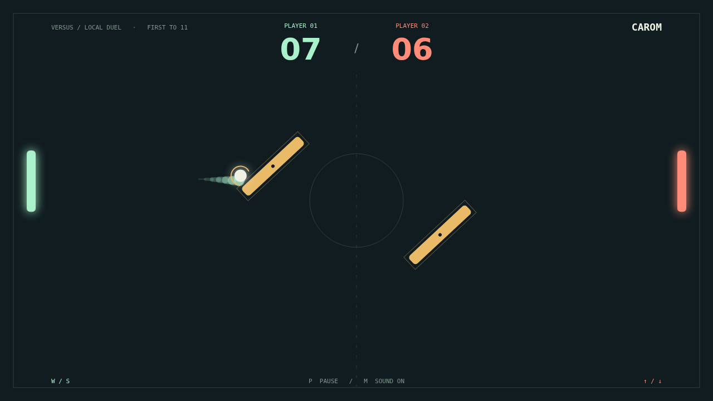

# Carom

Find your angle. Carom is a quick, precise paddle duel on a dark court, with two
moving obstacles between you and the far goal. Take on the computer in Solo, or
challenge a friend beside you in Versus.

The opening serve gives you a moment to settle in. Then each paddle hit picks up
speed. Meet the ball squarely for a straight return, or catch it near an edge to
send it climbing toward a wall. Stay moving through contact and your paddle adds
spin: a return that looks safe starts to bend.

The gold bars never stand still. They sway, turn, and send the ball off at fresh
angles. Read their faces to steal a bank shot, or recover when a promising return
comes straight back at you. A luminous trail lets you follow the curve through
the scramble.

Play to eleven, but win by two. At ten-all, every save buys another chance to
turn the rally around. One well-timed stroke can make the whole court yours.

